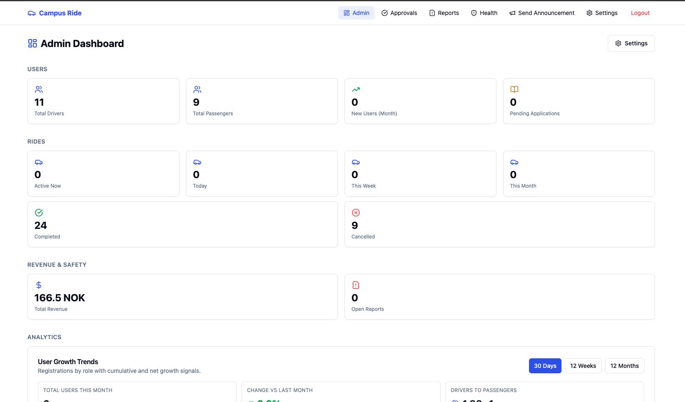
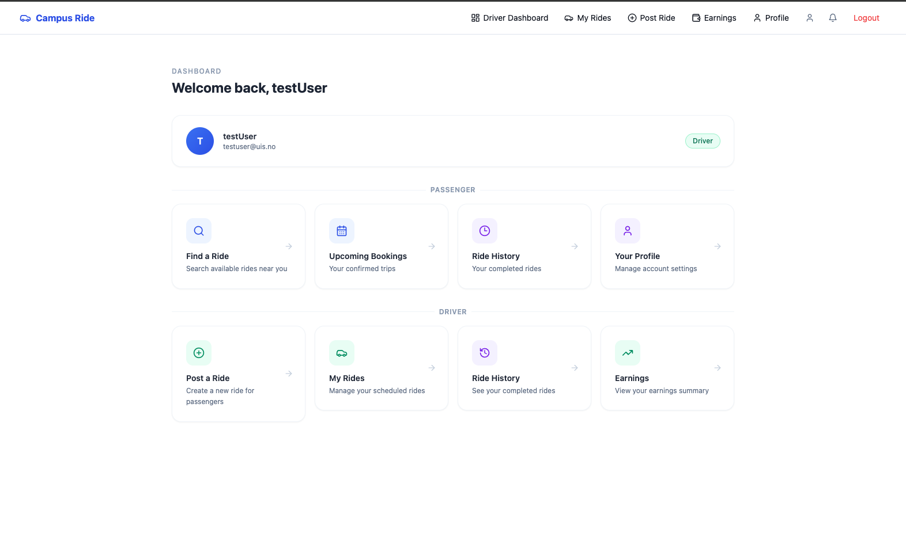
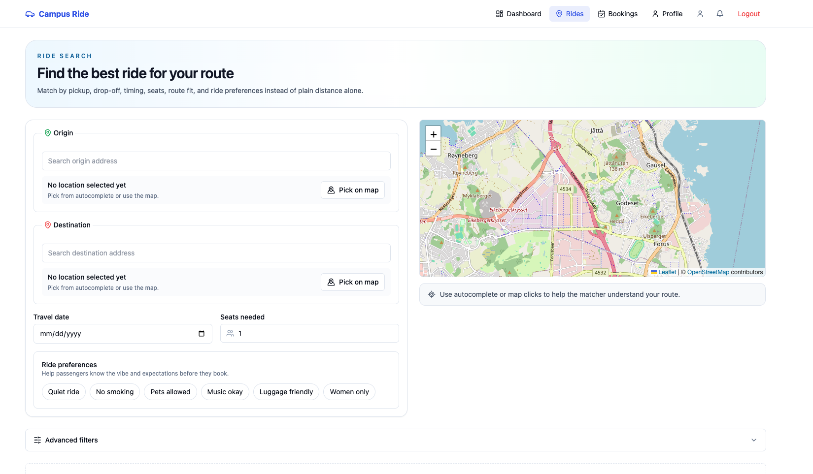

# Campus Ride Share App

A campus-focused ride sharing platform built by students, for students.

---

## Motivation

Living as an international student in the USA, public transport doesn't always get you where you need to go — and rideshare apps can be expensive. Campus Ride solves this by connecting students heading in the same direction.

Passengers get an affordable, reliable way to travel. Drivers earn pocket money on trips they were already making. It's a two-way handshake — everyone wins.

---

## How It's Built

| Layer    | Stack                                                          |
| -------- | -------------------------------------------------------------- |
| Frontend | React 18, Vite, Tailwind CSS, TanStack Query, Zustand, Leaflet |
| Backend  | Node.js, Express 4, TypeScript, Socket.io                      |
| Database | PostgreSQL (via Supabase), Prisma ORM                          |
| Auth     | Supabase Auth (JWT-based)                                      |
| Queue    | BullMQ + Redis (email jobs)                                    |
| Infra    | Docker Compose                                                 |

---

## Layout

```
campus-ride/
├── backend/
│   ├── src/
│   │   ├── admin/        — Driver approvals, moderation, platform health
│   │   ├── bookings/     — Booking lifecycle, payments, check-in
│   │   ├── chat/         — Real-time per-ride chat (Socket.io)
│   │   ├── config/       — Runtime platform settings
│   │   ├── lib/          — Prisma, Supabase, Redis, email queue singletons
│   │   ├── middleware/   — Auth guard, error handler, file upload
│   │   ├── payments/     — Stripe payment-intent helpers
│   │   ├── reports/      — User-filed reports
│   │   ├── rides/        — Ride posting, search, recurrence
│   │   ├── users/        — Auth flows, user profiles
│   │   └── workers/      — BullMQ email consumer
│   └── prisma/           — schema.prisma + seed.ts
├── frontend/
│   └── src/
│       ├── features/     — auth, rides, bookings, admin, chat, user, announcements
│       ├── components/   — Shared UI (Navbar, MapView, ProtectedRoute)
│       ├── api/          — Axios base client
│       ├── store/        — Zustand stores
│       └── lib/          — Shared utilities
├── .github/workflows/    — GitHub Actions CI
└── docker-compose.yml
```

---

## File Structure (Key Files)

| File                                          | Purpose                                             |
| --------------------------------------------- | --------------------------------------------------- |
| `backend/src/app.ts`                          | Express app setup, route mounting                   |
| `backend/src/middleware/auth.ts`              | JWT validation via Supabase + DB role lookup        |
| `backend/prisma/schema.prisma`                | Full data model                                     |
| `backend/prisma/seed.ts`                      | Demo data seeder                                    |
| `frontend/src/App.tsx`                        | Route definitions and auth guards                   |
| `frontend/src/features/auth/lib/authStore.ts` | Global auth state (Zustand)                         |
| `docker-compose.yml`                          | Full local stack (frontend, backend, worker, Redis) |

---

## Getting Started

### Prerequisites

| Tool             | Version   |
| ---------------- | --------- |
| Node.js          | 20+       |
| Docker Desktop   | latest    |
| Supabase account | free tier |

### Setup

```bash
# 1. Clone
git clone <your-repo-url> campus-ride
cd campus-ride

# 2. Copy env files and fill in your Supabase + SMTP credentials
cp backend/.env.example backend/.env
cp frontend/.env.example frontend/.env

# 3. Start everything
docker-compose up --build

# 4. Run migrations (in a second terminal)
docker-compose exec backend npx prisma migrate dev --name init

# 5. Seed demo data
docker-compose exec backend npx prisma db seed

# 6. Verify
curl http://localhost:8000/healthz
# → {"status":"ok"}
```

Open http://localhost:5173 in your browser.

---

## Testing Credentials

> Seed the database first with `docker-compose exec backend npx prisma db seed`

| Role              | Email                   | Password   |
| ----------------- | ----------------------- | ---------- |
| Admin             | amatte01@gettysburg.edu | 1234567890 |
| Driver (approved) | testuser@uis.no         | 1234567890 |
| Passenger         | apple@gettysburg.edu    | 1234567890 |

---

## Screenshots

### Admin Dashboard



### Driver Dashboard



### Passenger View



---

## Credits

- **Abiral Shrestha**
- **Tejaswi Amatya**
- **Rob Basnet**
- **Aashma Adhikari**
